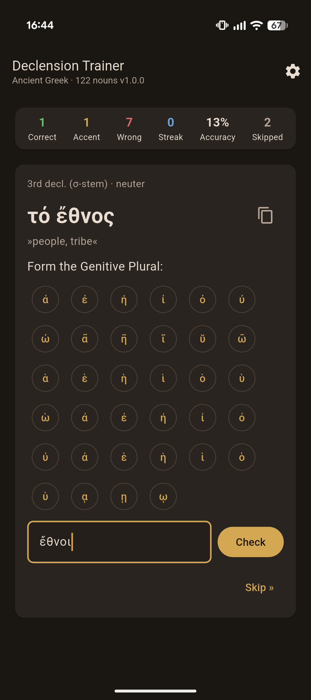

# Ancient Greek Trainer (Flutter/Android)

Native Android-App für den Altgriechisch-Deklinationstrainer. Die PWA im Repo-Root bleibt unverändert; die Logik aus `index.html` ist 1:1 nach Dart portiert (Filter, Fehlergewichtung, Antwortprüfung inkl. Akzente/Artikel, Statistik).

Lizenz: GNU GPL v3.0 (siehe `LICENSE` im Repo-Root). Nur Open-Source-Abhängigkeiten (Flutter SDK, `shared_preferences`).

## Screenshots

<p align="center">
  
  &nbsp;
  
</p>

## Voraussetzungen

- Flutter SDK (z. B. `brew install --cask flutter`)
- Android SDK + **Java 17** (AGP 8.x)
- Application-ID: `com.tioannidis.ancientgreektrainer`

## Start

```bash
flutter pub get
flutter run
```

## Tests & Build

```bash
flutter analyze
flutter test
flutter build apk --debug
```

## Wortschatz

`assets/nouns.json` ist die einzige Wortschatz-Quelle. Änderungen erfolgen direkt hier.
Jedes Substantiv besitzt ein `meanings`-Objekt mit einem Eintrag pro Sprachcode
(`de`, `en`).

## Sprachen / Übersetzungen

Die App folgt standardmäßig der Systemsprache. In den Einstellungen kann manuell
zwischen Systemsprache, Deutsch und Englisch gewählt werden.

Neue Sprache hinzufügen:

1. `lib/l10n/app_<code>.arb` anlegen und die Keys aus `lib/l10n/app_en.arb` übersetzen.
2. In `lib/l10n/languages.dart` einen `AppLanguage('<code>', '<Eigenname>')`-Eintrag ergänzen.
3. In `assets/nouns.json` unter `meanings` den neuen Sprachcode je Substantiv ergänzen.
4. In `android/app/src/main/res/xml/locales_config.xml` ein `<locale android:name="<code>" />` ergänzen.
5. `flutter pub get` (erzeugt `lib/l10n/generated/`), danach `flutter analyze` und `flutter test`.

Fehlende Übersetzungen fallen automatisch auf die Template-Sprache Englisch zurück.

## F-Droid / Sprachparameter

- Store-Metadaten gehören unter `fastlane/metadata/android/<locale>/`.
  `en-US` ist der Pflicht-Fallback; weitere Sprachen dürfen als reiner
  Sprachcode (`de`) oder mit Region (`de-DE`) abgelegt werden.
  Erwartete Dateien: `title.txt` (max. 50 Zeichen), `short_description.txt`
  (max. 80 Zeichen), `full_description.txt` (max. 4000 Zeichen) und
  `changelogs/<versionCode>.txt` (max. 500 Zeichen).
- In-App/Android: `android:localeConfig` im `AndroidManifest.xml` verweist auf
  `res/xml/locales_config.xml`. Damit bietet Android 13+ die systemweite
  Auswahl der App-Sprache an. Die dort gelisteten Codes müssen zu den
  Flutter-`supportedLocales` passen.
- Flutter: `supportedLocales` wird aus den ARB-Dateien generiert; `en` ist als
  Fallback zuerst gelistet.

Quellen: [F-Droid – Descriptions, Graphics and Screenshots](https://f-droid.org/docs/All_About_Descriptions_Graphics_and_Screenshots/),
[F-Droid – Submitting Guide](https://f-droid.org/docs/Submitting_to_F-Droid_Quick_Start_Guide/).

## Persistenz

`shared_preferences` mit denselben Keys wie die PWA: `greek_trainer_settings`, `greek_trainer_stats`, `greek_trainer_errors`.
