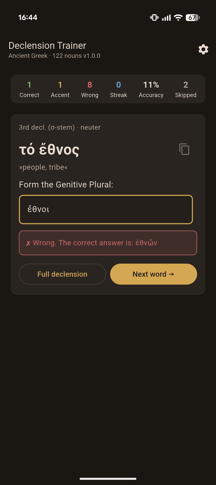

# Ancient Greek Trainer (Flutter/Android)

Native Android-App für den Altgriechisch-Deklinationstrainer. Die Logik (Filter, Fehlergewichtung, Antwortprüfung inkl. Akzente/Artikel, Statistik) ist in Dart implementiert.

Lizenz: GNU GPL v3.0 (siehe `LICENSE` im Repo-Root). Nur Open-Source-Abhängigkeiten (Flutter SDK, `shared_preferences`).

## Screenshots

<p align="center">
  
  &nbsp;
  
</p>

## Voraussetzungen

- Flutter SDK (z. B. `brew install --cask flutter`)
- Android SDK + **Java 17** (AGP 8.x)
- Application-ID: `com.tioannidis.ancientgreektrainer`

## Start

```bash
flutter pub get
flutter run
```

## Tests & Build

```bash
flutter pub get
flutter test
flutter build apk --release
```

Die Release-APK unter `build/app/outputs/flutter-apk/app-release.apk` ist absichtlich
unsigniert: F-Droid signiert die APK mit eigenem Schlüssel. Sie lässt sich deshalb
nicht direkt sideloaden.

Für lokale Tests ein Debug-APK bauen. Es ist mit dem Android-Debug-Key signiert und
lässt sich direkt installieren:

```bash
flutter build apk --debug
```

## Wortschatz

`assets/nouns.json` ist die einzige Wortschatz-Quelle. Änderungen erfolgen direkt hier.
Jedes Substantiv besitzt ein `meanings`-Objekt mit einem Eintrag pro Sprachcode
(`de`, `en`).

122 Substantive mit je 10 expliziten Formen (5 Kasus × 2 Numeri):

| Deklination | Typ | Anzahl | Beispiele |
|---|---|---|---|
| 1. Dekl. | Feminina auf -η (`1_eta`) | 14 | ψυχή, ἀρχή, τέχνη |
| 1. Dekl. | Feminina auf -ᾱ (`1_alpha_long`) | 8 | χώρα, ἡμέρα, οἰκία |
| 1. Dekl. | Feminina auf -ᾰ (`1_alpha_short`) | 5 | θάλαττα, γλῶττα, δόξα |
| 1. Dekl. | Maskulina auf -ης (`1_masc_hs`) | 6 | πολίτης, ποιητής, μαθητής |
| 1. Dekl. | Maskulina auf -ας (`1_masc_as`) | 1 | νεανίας |
| 2. Dekl. | Mask./Fem. auf -ος (`2_masc`) | 19 | λόγος, ἄνθρωπος, θεός |
| 2. Dekl. | Neutra auf -ον (`2_neut`) | 8 | ἔργον, δῶρον, τέκνον |
| 3. Dekl. | Verschlusslaute/τ-Stämme (`3_stop`) | 15 | φύλαξ, ἐλπίς, πατρίς |
| 3. Dekl. | Nasale, ν-Stämme (`3_nasal`) | 8 | δαίμων, ἡγεμών, Ἕλλην |
| 3. Dekl. | ντ-Stämme (`3_nt`) | 5 | γέρων, ἄρχων, λέων |
| 3. Dekl. | Liquida, ρ-Stämme (`3_liquid`) | 7 | ῥήτωρ, πατήρ, μήτηρ |
| 3. Dekl. | σ-Stämme (`3_sigma`) | 9 | γένος, ἔθνος, ἔτος |
| 3. Dekl. | ι-Stämme (`3_vowel_is`) | 9 | πόλις, φύσις, δύναμις |
| 3. Dekl. | ευ-Stämme (`3_vowel_eus`) | 8 | βασιλεύς, ἱερεύς, ἱππεύς |

Neue Wörter werden in `assets/nouns.json` ergänzt. Format eines Eintrags:

```json
{
  "lemma": "φιλόσοφος",
  "gender": "m",
  "type": "2_masc",
  "meanings": {
    "de": "Philosoph",
    "en": "philosopher"
  },
  "forms": {
    "sg": {
      "nom": "φιλόσοφος",
      "gen": "φιλοσόφου",
      "dat": "φιλοσόφῳ",
      "acc": "φιλόσοφον",
      "voc": "φιλόσοφε"
    },
    "pl": {
      "nom": "φιλόσοφοι",
      "gen": "φιλοσόφων",
      "dat": "φιλοσόφοις",
      "acc": "φιλοσόφους",
      "voc": "φιλόσοφοι"
    }
  }
}
```

Verfügbare Typen: `1_eta` · `1_alpha_long` · `1_alpha_short` · `1_masc_hs` ·
`1_masc_as` · `2_masc` · `2_neut` · `3_stop` · `3_nasal` · `3_liquid` ·
`3_sigma` · `3_vowel_is` · `3_vowel_eus` · `3_nt`

Geschlecht: `m` (maskulin) · `f` (feminin) · `n` (neutrum)

## Sprachen / Übersetzungen

Die App folgt standardmäßig der Systemsprache. In den Einstellungen kann manuell
zwischen Systemsprache, Deutsch und Englisch gewählt werden.

Neue Sprache hinzufügen:

1. `lib/l10n/app_<code>.arb` anlegen und die Keys aus `lib/l10n/app_en.arb` übersetzen.
2. In `lib/l10n/languages.dart` einen `AppLanguage('<code>', '<Eigenname>')`-Eintrag ergänzen.
3. In `assets/nouns.json` unter `meanings` den neuen Sprachcode je Substantiv ergänzen.
4. In `android/app/src/main/res/xml/locales_config.xml` ein `<locale android:name="<code>" />` ergänzen.
5. `flutter pub get` (erzeugt `lib/l10n/generated/`), danach `flutter analyze` und `flutter test`.

Fehlende Übersetzungen fallen automatisch auf die Template-Sprache Englisch zurück.

## F-Droid / Sprachparameter

- Store-Metadaten gehören unter `fastlane/metadata/android/<locale>/`.
  `en-US` ist der Pflicht-Fallback; weitere Sprachen dürfen als reiner
  Sprachcode (`de`) oder mit Region (`de-DE`) abgelegt werden.
  Erwartete Dateien: `title.txt` (max. 50 Zeichen), `short_description.txt`
  (max. 80 Zeichen), `full_description.txt` (max. 4000 Zeichen) und
  `changelogs/<versionCode>.txt` (max. 500 Zeichen).
- In-App/Android: `android:localeConfig` im `AndroidManifest.xml` verweist auf
  `res/xml/locales_config.xml`. Damit bietet Android 13+ die systemweite
  Auswahl der App-Sprache an. Die dort gelisteten Codes müssen zu den
  Flutter-`supportedLocales` passen.
- Flutter: `supportedLocales` wird aus den ARB-Dateien generiert; `en` ist als
  Fallback zuerst gelistet.

Quellen: [F-Droid – Descriptions, Graphics and Screenshots](https://f-droid.org/docs/All_About_Descriptions_Graphics_and_Screenshots/),
[F-Droid – Submitting Guide](https://f-droid.org/docs/Submitting_to_F-Droid_Quick_Start_Guide/).
